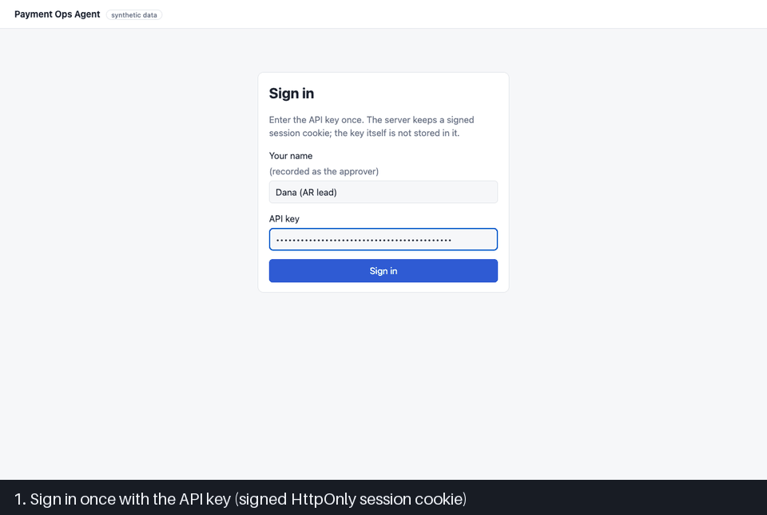
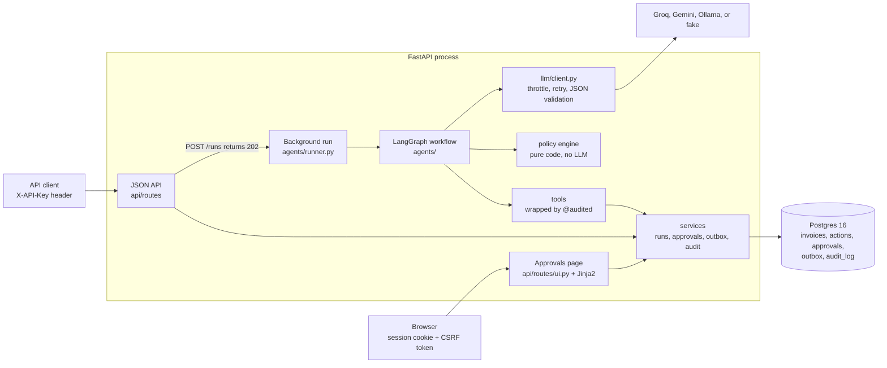
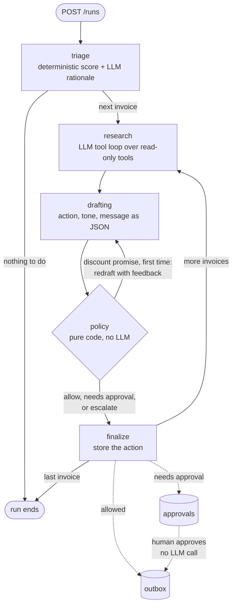

# Payment Ops Agent

An agent that triages overdue invoices, researches each customer's payment history,
drafts follow-ups, and routes risky actions to a human for approval. The LLM proposes;
plain, deterministic code decides what may be sent. Every LLM call, tool call, and policy
decision is recorded in an audit log, and nothing reaches a customer without passing the
policy engine.

All data is synthetic. Nothing is ever really paid or emailed: "sent" messages are rows
in the `outbox` table.

- **FastAPI + Postgres 16 + LangGraph**, sync SQLAlchemy 2, Alembic migrations
- **Deterministic guardrails**: no reminders on disputed invoices, no discount promises,
  human approval over a balance threshold and for every payment-plan offer
- **Human in the loop**: a server-rendered approvals page (Jinja2, no JavaScript). The
  approver signs off on the exact text that gets sent, with no LLM call afterwards
- **Free-tier friendly LLM layer** (LiteLLM): Groq, Gemini, Ollama, or a deterministic fake;
  client-side throttling, retries with backoff that honor `Retry-After`, validated JSON output
- **Measured**: a 40-scenario eval with a markdown report, and a Locust load test



## Results

**Agent quality**: [eval report](evals/reports/2026-11-16T08-10-00_openai-gpt-oss-120b_v1.md),
Groq `openai/gpt-oss-120b`, prompts v1, dataset v1 (40 scenarios), 1 repeat.

| Metric | Value |
|---|---:|
| Decision accuracy | 87.5% |
| Task success rate (right action, approval flag, no policy hit, valid output) | 87.5% |
| Acceptable-action rate | 97.5% |
| Approval-flag accuracy | 92.5% |
| Tool-call precision / recall | 100% / 100% |
| Schema-valid LLM outputs | 100% |
| Policy violations reaching the outbox | **0** |
| Latency per run, p50 / p95 | 48.5 s / 58.6 s |
| Tokens per run (average) | 5,984 |

**Eval latency includes free-tier rate-limit throttling.** Each run makes about 6 LLM
calls and 6K tokens, and the client deliberately waits to stay under Groq's free-tier
limit of 8K tokens per minute (plus any backoff after a 429). Most of the ~50 s is that
waiting, not model time; a paid tier or a local model would be much faster.

The 5 failures are all judgment calls, not guardrail failures: three reminders where a
payment-plan offer was expected (customers with partial payments or a long late history),
one reminder on an invoice not yet due, and one escalation where no action was expected.

**API load test** ([benchmarks/results.md](benchmarks/results.md), MacBook Air M5, fake LLM
so it measures the API and Postgres rather than a provider's rate limits):

| Load | Requests | Errors | p50 | p95 | p99 | Throughput |
|---|---:|---:|---:|---:|---:|---:|
| 50 users, 5 min | 11,697 | 0 | 7 ms | 17 ms | 33 ms | 39 req/s (bounded by think time) |
| 200 users, 2 min | 18,429 | 0 | 6 ms | 28 ms | 63 ms | 154 req/s |

## Quickstart

Requirements: Docker (with Compose), `make`, and `python3`. No LLM API key is needed.

```bash
git clone https://github.com/HarshaM30/payment-ops-agent.git
cd payment-ops-agent
cp .env.example .env
make demo
```

`make demo` replaces the placeholder `API_KEY` and `SESSION_SECRET` in `.env` with random
values (values you already set are kept), starts Postgres and the API with the fake LLM,
and seeds 60 synthetic customers. Then:

1. Open <http://localhost:8000/ui/login>. Sign in with your name and the `API_KEY` from
   `.env` (`grep ^API_KEY= .env`).
2. **Runs** → *Start run over overdue invoices*. The run page refreshes until it finishes
   and shows the ordered trace.
3. **Approvals** → read the drafted message and the policy rules that require sign-off,
   then *Approve and send* or reject with a reason.
4. **Outbox** shows the simulated sent message.

The JSON API and its interactive docs are at <http://localhost:8000/docs> (use **Authorize**
with the same key). Stop everything with `make down`.

**With a real model:** set `LLM_PROVIDER` and the matching key in `.env`, then `make up`
(`make demo` always uses the fake provider). Leave `LLM_MODEL` empty for the default:

| Provider | Default model | Notes |
|---|---|---|
| `groq` | `openai/gpt-oss-120b` | Free plan (about 30 requests/min, 8K tokens/min). Llama models need an Enterprise plan |
| `gemini` | `gemini-3.5-flash-lite` | Free tier |
| `ollama` | `llama3.2` | Local; run `ollama pull llama3.2` first |
| `fake` | `fake-v1` | Deterministic, no key; used by tests, CI, the demo, and load tests |

The free-tier limits above were checked on 2026-11-15 and can change. The client throttles
itself (`LLM_REQUESTS_PER_MINUTE`, `LLM_TOKENS_PER_MINUTE`) to stay under them.

**For development** (the API runs on your machine with reload; needs [uv](https://docs.astral.sh/uv/)):

```bash
make install              # uv sync (installs Python 3.12 if needed)
make db                   # only Postgres 16 in Docker
make migrate              # alembic upgrade head
make seed                 # deterministic synthetic customers, invoices, payments
make run                  # http://localhost:8000
```

## Architecture



- Layering: `api/routes` → `services` → `db/models`. The agents call `tools/`, which call
  `services`. The JSON API and the approvals page share `services/approvals.py`, so the
  approval logic exists once.
- Runs execute in-process (FastAPI `BackgroundTasks`), one API process per database. A
  job queue is the next step at scale.
- LLM access goes only through `llm/client.py`; the provider and model come from
  `LLM_PROVIDER` / `LLM_MODEL`.

## How a run works



- **Triage** scores each invoice 0–100 from deterministic features (days overdue, balance,
  payment history). The LLM adds a rationale and can move a score by at most 20 points.
- **Research** is an LLM tool-calling loop over the read-only tools, capped at
  `RESEARCH_MAX_STEPS` rounds.
- **Drafting** picks `reminder`, `payment_plan_offer`, `escalate_to_human`, or `no_action`,
  picks a tone, and writes the message as JSON validated by a Pydantic schema (one
  corrective re-prompt on invalid output).
- **Policy** is plain code, no LLM (`src/payops/policy/`):

  | Rule | Effect |
  |---|---|
  | `SCHEMA_VALID` | Invalid LLM output is blocked and escalated |
  | `NO_REMINDER_ON_DISPUTED` | No reminder or plan offer on a disputed invoice; escalated instead |
  | `NO_DISCOUNT_PROMISES` | Discount, waiver, "% off", "forgive" (regex/keyword list) is blocked; one redraft with feedback, then escalated |
  | `APPROVAL_OVER_THRESHOLD` | Balance over `APPROVAL_THRESHOLD_AMOUNT` needs human approval |
  | `APPROVAL_FOR_PAYMENT_PLAN` | Every payment-plan offer needs human approval |

- **Finalize** stores the action. Allowed actions run immediately (messages become outbox
  rows). Anything needing approval creates an approval and the run ends as
  `awaiting_approval`. Approving sends the stored text exactly as written, with no further
  LLM call, after re-checking the policy against the invoice's current state.

Every LLM call, tool call, node decision, and policy result is written to `audit_log` with
tokens and latency, and shows up in order in `GET /runs/{id}` and on the run page. If the
provider keeps failing after retries (backoff with jitter on 429/5xx/timeouts, honoring
`Retry-After`), the run ends as `failed` with the error.

## Approvals page

Server-rendered HTML (Jinja2) with one small CSS file and no JavaScript.

| Page | What it does |
|---|---|
| `/ui/login` | Enter your name (recorded as the approver) and the API key, once |
| `/ui/approvals` | Pending approvals: customer, invoice, balance, proposed action, drafted message, and the policy rules that triggered approval. Approve, or reject with a reason |
| `/ui/runs`, `/ui/runs/{id}` | Start a run; live status, actions, and the ordered trace with tokens and latency |
| `/ui/outbox` | Read-only list of simulated sent messages |

Security:

- Login checks the key in constant time and sets a signed session cookie (`itsdangerous`,
  `SESSION_SECRET`, 8 hours): `HttpOnly`, `SameSite=Strict`, `Path=/ui`, and `Secure` when
  `SESSION_COOKIE_SECURE=true`. The cookie holds the approver name, a CSRF token, and a
  keyed fingerprint of the API key, never the key itself, so rotating `API_KEY` signs
  every browser out.
- Every form POST (including login and sign-out) carries a CSRF token; a missing or wrong
  token gets a `403`. A request without a valid session is redirected to the login page.
- Jinja2 auto-escapes everything. Drafted messages are LLM output and render as text,
  never as HTML; a Content-Security-Policy with no script sources backs this up.
- Approve and reject call the same `services/approvals.py` functions as the JSON API.

## API

| Method | Path | Notes |
|---|---|---|
| `GET` | `/health` | Open. `200` with DB status, `503` if the DB is unreachable |
| `POST` | `/runs` | `{"invoice_ids": [...]}` or `{"scope": "all_overdue"}`, optional `max_invoices`. Returns `202` + run id. Optional `Idempotency-Key` header: a retry returns the same run; the same key with another body is `409` |
| `GET` | `/runs/{id}` | Status, token/latency totals, and the ordered trace from `audit_log` |
| `GET` | `/approvals?status=pending` | Paginated (`limit` ≤ 200, `cursor`) |
| `POST` | `/approvals/{id}/approve` | `{"approver": "..."}`. Sends the drafted message as written (an outbox row); `409` if already decided or now blocked by policy |
| `POST` | `/approvals/{id}/reject` | `{"approver": "...", "reason": "..."}` |
| `GET` | `/audit?run_id=&event_type=&limit=&cursor=` | Paginated audit log, newest first |

Every endpoint except `/health` needs an `X-API-Key` header matching `API_KEY`. Errors
always look like `{"error": {"code": "...", "message": "...", "details": [...]}}`. Every
response carries an `X-Request-ID` (yours if you send a valid one), which also appears in
every log line for that request. A database outage returns `503` with `Retry-After`, and a
request slower than `REQUEST_TIMEOUT_SECONDS` returns `504`.

## Configuration

All settings are environment variables, read from `.env` by `src/payops/config.py` and
validated at startup (the process refuses to start with a missing, short, or placeholder
`API_KEY` / `SESSION_SECRET`). [.env.example](.env.example) lists every variable with a
comment.

| Variable | Default | Purpose |
|---|---|---|
| **Application** | | |
| `APP_ENV` | `development` | `development`, `test`, or `production` |
| `LOG_LEVEL` | `INFO` | Structured JSON logs |
| `API_HOST`, `API_PORT` | `0.0.0.0`, `8000` | Where the API listens |
| `REQUEST_TIMEOUT_SECONDS` | `30` | Slower requests get a `504` |
| `RUN_RECOVERY_ON_STARTUP` | `true` | Mark runs orphaned by a previous process as `failed` |
| `RUN_FAIL_RETRY_SECONDS` | `120` | How long to keep retrying to record a crashed run while the DB is down |
| **Security** | | |
| `API_KEY` | required | `X-API-Key` for the JSON API; also the approvals-page login. 32+ characters |
| `SESSION_SECRET` | required | Signs the session cookie and CSRF tokens. 32+ characters, different from `API_KEY` |
| `SESSION_COOKIE_SECURE` | `false` | Set `true` when served over HTTPS |
| **Database** | | |
| `POSTGRES_USER`, `POSTGRES_PASSWORD`, `POSTGRES_DB`, `POSTGRES_PORT` | `payops`, `change-me`, `payops`, `5432` | Used by Compose to create the database |
| `DATABASE_URL` | required | SQLAlchemy URL; host `localhost` on the Mac, `db` inside Compose |
| `TEST_DATABASE_URL` | | Database for integration tests |
| `DB_POOL_SIZE`, `DB_MAX_OVERFLOW` | `5`, `10` | Connection pool per API process |
| `DB_POOL_TIMEOUT_SECONDS` | `10` | Wait for a pooled connection, then `503` |
| `DB_CONNECT_TIMEOUT_SECONDS` | `5` | |
| `DB_STATEMENT_TIMEOUT_MS` | `15000` | Server-side cap per SQL statement; `0` disables |
| **LLM** | | |
| `LLM_PROVIDER` | `fake` | `groq`, `gemini`, `ollama`, or `fake` |
| `LLM_MODEL` | empty | Empty means the provider default (table above) |
| `GROQ_API_KEY`, `GEMINI_API_KEY` | | Only the one for your provider |
| `OLLAMA_API_BASE` | `http://localhost:11434` | |
| `FAKE_LLM_LATENCY_MS` | `0` | Simulated latency for the fake provider (`make demo` uses 150) |
| `LLM_TEMPERATURE` | `0.2` | |
| `LLM_TIMEOUT_SECONDS` | `30` | Hard timeout per call |
| `LLM_MAX_RETRIES` | `5` | Retries on 429, 5xx, and timeouts |
| `LLM_BACKOFF_BASE_SECONDS`, `LLM_BACKOFF_MAX_SECONDS` | `1.0`, `60` | Exponential backoff with full jitter |
| `LLM_REQUESTS_PER_MINUTE`, `LLM_TOKENS_PER_MINUTE` | `25`, `5000` | Client-side throttle; `0` disables |
| **Agent and policy** | | |
| `PROMPT_VERSION` | `v1` | Loads `agents/prompts/<node>_<version>.md`; stored on each run |
| `RESEARCH_MAX_STEPS` | `5` | Cap on LLM tool-calling rounds per invoice |
| `APPROVAL_THRESHOLD_AMOUNT` | `10000` | Balances above this need human approval |
| `DEFAULT_CURRENCY` | `USD` | |
| **Seed and eval** | | |
| `SEED_RANDOM_SEED`, `SEED_NUM_CUSTOMERS` | `42`, `60` | Deterministic synthetic data |
| `EVAL_DATABASE_URL` | empty | Wiped before every scenario; empty means `DATABASE_URL` + `_eval` |
| `EVAL_DATASET_VERSION` | `v1` | Which `evals/datasets/<version>` to run |
| `EVAL_REPEATS` | `1` | Runs per scenario; above 1, metrics are mean ± std |
| `EVAL_REPORTS_DIR` | `evals/reports` | |

## Agent tools

Plain typed functions in `src/payops/tools/`, each exported with a JSON schema for the LLM
and wrapped by `@audited`, so every call writes exactly one `audit_log` row:
`get_customer`, `get_invoices`, `get_payment_history`, `draft_message`, `schedule_followup`,
`flag_for_review`. The write tools only create *proposed* actions; nothing is sent from a tool.

## Evaluation

`make eval` runs the 40 scenarios in `evals/datasets/v1/` through the real agent graph,
each in a fresh, dedicated eval database (`payops_eval`), and writes a markdown report to
`evals/reports/`. It scores decision accuracy, task success, tool-call precision/recall,
policy violations caught vs. reaching the outbox, p95 latency, and tokens.

```bash
make eval LLM_PROVIDER=fake         # smoke run, no API key (what CI runs)
make eval                           # with the provider in .env, e.g. Groq
make eval REPEATS=3                 # metrics as mean ± std, plus per-scenario consistency
make eval LIMIT=10                  # stop after 10 more scenarios
make eval-compare A=evals/reports/<a>.md B=evals/reports/<b>.md
```

A full Groq run needs more tokens than the free tier's daily quota, so the runner is
resumable: each finished scenario is saved to `evals/runs/<config>/results.jsonl`, a
rerun skips them, a rate limit stops the run cleanly (exit code 75), and the report is
written once all scenarios are done. Just run the same `make eval` again the next day.

## Load testing

```bash
LLM_PROVIDER=fake docker compose up -d --wait --build
make bench                          # Locust: 50 users for 5 minutes (USERS=, SPAWN=, TIME=)
```

Results and machine specs are in [benchmarks/results.md](benchmarks/results.md).

## Seed scenarios

The seed tags every customer with a `scenario_type`, which the evaluation dataset reuses:

| Scenario | What it looks like |
|---|---|
| `current` | Open invoice not yet due, pays on time |
| `reliable_slightly_late` | One invoice 3–10 days overdue, good history |
| `chronic_late` | 2–3 invoices 30–90 days overdue, broken promise to pay |
| `disputed_invoice` | Invoice in `disputed` status with a dispute event |
| `large_balance` | Overdue balance above the approval threshold |
| `partial_payments` | Overdue invoice partly paid in installments |
| `recent_payment_plan` | Active payment plan started in the last few weeks |

The seed is deterministic for a given `SEED_RANDOM_SEED` and day, and truncates all tables
before inserting, so running it twice gives the same data.

## Development

```bash
make lint        # ruff check + format check
make test-unit   # no database, no API keys
make test-int    # needs `make db` (or `make up`)
make cov         # all tests + coverage gate on tools/, services/, api/
make demo-gif    # re-record docs/demo.gif from a running `make demo` (needs Google Chrome)
```

`make demo-gif` drives the approvals page with Playwright in headless Chrome and stitches
the screenshots into a GIF with Pillow; both are fetched on the fly with `uv run --with`
and are not project dependencies.

CI (GitHub Actions) runs lint, unit tests, integration tests against a Postgres service
container, and a fake-LLM eval smoke run. It needs no secrets.

## Deploying to the cloud (guide only)

> **This project is not deployed.** It runs locally only. This section is a guide to how
> it could be deployed; none of it has been set up or tested in a cloud account.

A minimal production shape on **Google Cloud** (the AWS equivalents are in brackets):

1. **Database**: Cloud SQL for PostgreSQL 16 [RDS for PostgreSQL], private IP only,
   automated backups. The app needs one database plus, if you run evals there, a separate
   eval database.
2. **Image**: build the existing multi-arch `Dockerfile` and push it to Artifact Registry
   [ECR]. It already runs as a non-root user and has a `/health` check.
3. **Secrets**: `API_KEY`, `SESSION_SECRET`, the database password, and any LLM key go in
   Secret Manager [Secrets Manager], exposed to the container as environment variables.
   Never bake them into the image (`.dockerignore` already excludes `.env`).
4. **Migrations as a job**: the image's default command runs `alembic upgrade head` before
   starting uvicorn. In the cloud, run migrations once per release as a Cloud Run Job
   [a one-off ECS task] with the command `alembic upgrade head`, and start the service
   with only the uvicorn command, so several instances never race to migrate.
5. **Service**: Cloud Run [ECS on Fargate behind an ALB] with
   `APP_ENV=production`, `SESSION_COOKIE_SECURE=true` (it is served over HTTPS), and
   `DATABASE_URL` pointing at Cloud SQL (via the Cloud SQL connector's Unix socket,
   `postgresql+psycopg://user:pass@/payops?host=/cloudsql/PROJECT:REGION:INSTANCE`).
6. **Runs execute in-process**, so two settings matter: keep CPU allocated after the
   response returns (Cloud Run "instance-based billing" / CPU always allocated; Fargate
   does this by default), or background runs stall; and run **exactly one instance**
   (min = max = 1, or ECS desired count 1), because startup recovery assumes one API
   process per database. Scaling past one instance means moving runs to a job queue
   (Cloud Tasks or Pub/Sub [SQS]) with a separate worker service.
7. **Observability**: logs are already structured JSON with a request id, so Cloud Logging
   [CloudWatch Logs] can filter on `request_id`, `run_id`, and `status`. Alert on failed
   runs and on `/health` returning `503`.
8. **Network**: allow `/health` from the load balancer; put the API behind HTTPS only. The
   approvals page could additionally sit behind Identity-Aware Proxy [Cognito on the ALB]
   so approvers sign in with SSO instead of the shared API key.

## More

- [PLAN.md](PLAN.md): milestones, checklists, and the design decisions log
- [evals/datasets/v1/README.md](evals/datasets/v1/README.md): the eval dataset format
